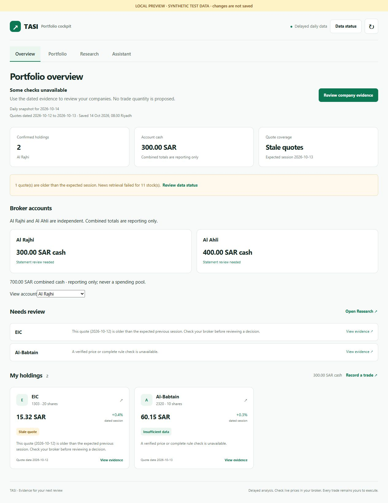

# Cockpit refresh: implementation and release preview

Verified locally on 14–15 October 2026. Branch: `codex/tasi-cockpit-refresh`.
Baseline: `7987e5125b75be226c076bc8974dd703844644d7`.
Implementation: `a6e775f`, `00b6aa6`, `8916029`; independent-review fixes: `7f2253b`.

The implementation is ready for release review. Production has not been changed,
and no Discord message or portfolio write was sent during this work.

## Delivered behavior

- Four views: Overview, Portfolio, Research and Assistant, with deep links and
  browser history. The home prioritizes confirmed accounts, holdings and reviews.
- Light responsive cards, visible focus, company details, charts and source
  status behind deliberate actions. Empty experimental forecast/pulse panels
  leave the home; stored movement history and offline research remain available.
- Quote age is evaluated for holdings and watchlist using an optional expected
  session date from the existing holiday calendar. Missing, stale and current
  quotes remain distinct from the artifact save time.
- Failed, uncollected and successfully empty sources remain distinct. Missing
  accounts and policy configuration cannot imply a completed review or zero risk.
- Independent Al Rajhi/Al Ahli cash, readable activity and correction targets,
  existing preview/confirmation writes, reconciliation and retry protection.
- Labeled evidence fields use the existing official-source and metric validator.
- One concise daily Discord brief, up to three changes and a cockpit link.
  Extra tracked-company events and source transitions are deduplicated. Routine
  chart images leave the daily message; chart data remains in the artifact.
- Existing unsupported `/bought` and `/sold` replies direct users to Portfolio.
  Schedules, experimental publication flags and manual trade execution persist.

## Verification

| Check | Observed result |
| --- | --- |
| `python -m compileall -q main.py movement.py session_gate.py runtime research` | Passed |
| Current Python CI tests plus `test_cockpit_refresh.py` | 435 passed |
| `npm run lint` | Passed |
| `npm run typecheck` | Passed |
| `npm test` | Build, 160 Node tests and 84 UI tests passed |
| Fresh Python sample artifact parsed by `tests/producer-contract.test.mjs` | 4 passed |
| `npm run build:cloudflare` | Passed |
| `npx wrangler deploy --dry-run --config dist/server/wrangler.json` | Passed; exited without publishing |
| `npm audit --omit=dev` | 0 vulnerabilities |
| `git diff --check` | Passed |

Python command:

```powershell
python -m pytest test_core.py test_alert_names.py test_runtime.py research/test_base_rate.py research/test_entry_forecast.py research/test_event_study.py research/test_official_sources.py test_cockpit_refresh.py -q
```

Some isolated UI attempts exceeded local time limits while preview processes
were running. The final unmodified `npm test` completed successfully, including
all 84 UI tests; test deadlines were not increased to obtain that result.

The package targets the existing `tasi-action-cockpit` Worker and D1 binding
`DB`, with the existing Cloudflare authentication configuration. No schema,
credential, provider or schedule change is required by this refresh.

The compatible Next/eslint-config-next update to 16.3.8 and locked transitive
patches remove production audit findings. The full audit still reports 21
development-tool findings (18 high, 2 moderate, 1 low); no forced major toolchain
upgrade was included.

## Browser preview

These screenshots show the real local application with clearly labeled synthetic
fixtures. The balances, positions and dates are demonstration inputs. They are
not a live portfolio or evidence that production providers are healthy.



[Mobile preview](assets/cockpit-refresh-mobile.jpg)

Exercised all four views, company details/chart/source states, Escape/focus
return, broker selection, structured evidence fields and failed portfolio and
assistant requests with draft preservation. At the mobile override of 390×844,
Overview, Portfolio and Research had a 375-pixel usable document width and equal
scroll width, with no horizontal overflow. The viewport was reset afterward.

The local proxy blocked writes and provider calls. Successful account writes,
conflicts, evidence validation and retries are covered by automated tests; the
browser exercise does not claim a live production write or model response.

## Offline Discord preview

Rendered by the production formatter using synthetic inputs; 463 characters
including the title separator. Nothing was sent to Discord.

```text
TASI daily brief · 2026-10-13
Delayed quotes: 2026-10-12
Confirm your broker account opening snapshots.
• Trend changed · Example company 1 (4000); review chart.
• Trend changed · Example company 2 (4001); review chart.
• Trend changed · Example company 3 (4002); review chart.
5 more changes in the cockpit.
Data: News unavailable for 8 stock(s); Filings not collected for 8 stock(s)
[Open cockpit](https://tasi-action-cockpit.ronaldinho1415.workers.dev)
```

## Independent review and decisions

One fresh-context whole-branch reviewer found four Important issues. Each was
reproduced by a failing test before the fix; all final suites pass.

| Finding | Resolution |
| --- | --- |
| Scheduled event alerts read an archive not retained across Actions jobs | Read the research job's persisted announcement queue |
| Missing tracked records could falsely restore full source coverage | Treat incomplete coverage as unavailable/unknown |
| Correction targets were opaque; replacement details were hidden | Show amount, time, revision and replacement summary |
| Old headlines could explain a current movement while hidden from the view | Filter dated headlines before movement classification |

No Critical findings or deferred Minor findings.

Rulings, in execution order:

1. Use compatible existing dependency patches, with no added dependency.
   Cost if wrong: runtime compatibility; covered by builds, tests and dry-run.
2. Leave live deployment and actual Discord receipt for release qualification.
   Cost if wrong: hosted behavior/delivery can still fail despite local checks.
3. Fix the preview proxy's dropped CSS Accept header in the harness only.
   A control request confirmed Vite's content negotiation. Cost if wrong: a
   hosted stylesheet defect could remain; visible previews and canonical build
   provide local coverage.
4. The executor supplies full-suite verification; the reviewer supplies focused
   reproductions. Cost if wrong: integration coverage depends on those suites.
5. Isolate the quiet-session test from generated local dashboard files. Its
   previous assertion depended on machine state. Cost if wrong: combined-mode
   gaps; the persisted-queue integration test covers notification dispatch.

## Remaining release qualification

The earlier live read-only diagnosis found stale daily/watchlist data, missing
news and insufficient TASI index history. A current-source probe returned only
one bar for the configured `^TASI.SR` index, while a stock history returned 126
bars. This refresh exposes these limitations; it does not manufacture index
history, company assessments, balances or reliable entry forecasts.

After approval of this preview:

1. Integrate the branch against current `main`, preserving newer machine state,
   and verify CI on the integrated commit. Record the current Worker version and
   producer SHA for rollback before publishing.
2. Build and deploy through `npm run deploy:cloudflare` to the existing Worker.
   No database reset or new migration is part of this release.
3. Verify authenticated loading, all four views, assets and broker read paths on
   the hosted site. Trigger the existing guarded refresh using released producer
   code; verify the actual saved quote dates and separate delivery receipts.
4. Verify one authorized real Discord interaction/delivery and its receipt.
   A deployment or CI badge alone is not proof of command behavior.
5. If qualification fails, roll back the Worker to the recorded version and the
   producer to the prior code, preserving portfolio records and generated data.

No root machine-written JSON changed in this branch. The original checkout's
unrelated draft and untracked research files remain untouched.
