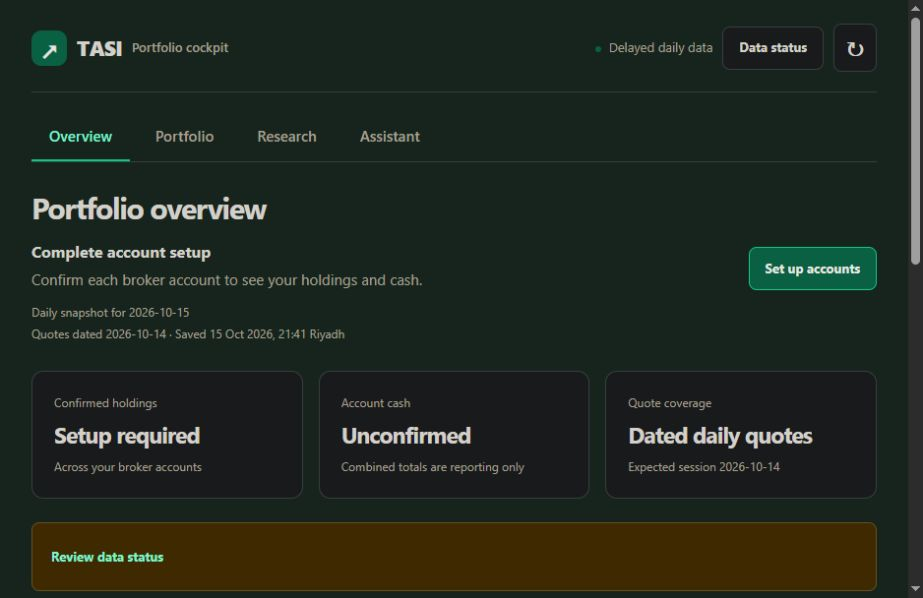

# Cockpit refresh production release

The owner approved publishing the concrete preview on 15 October 2026.

- [Refresh PR #27](https://github.com/abdullah7041/TASI-stock-alert/pull/27)
  merged as `903c6600e99438c7f7ce3212ef047f1ec6b787b7`.
- [CI on the merged commit](https://github.com/abdullah7041/TASI-stock-alert/actions/runs/38787336696)
  passed Python, web and current-producer contract jobs.
- The canonical Cloudflare build deployed to the existing
  [cockpit](https://tasi-action-cockpit.ronaldinho1415.workers.dev/), version
  `995c783c-014f-4d26-a421-77393abf7362`. The deployed commit binding matches
  `903c6600e99438c7f7ce3212ef047f1ec6b787b7`.
- Rollback reference: prior Worker version
  `18d381bd-1a0d-4bc5-b57d-02f6e696bfe8`; prior producer main `194a5fc`.
  Rollback must preserve portfolio data and newer generated state.

## Live qualification

The authenticated production browser shows the new views and account setup
states. Both broker opening snapshots remain unconfirmed; no balances or
holdings were invented or recorded by this release.

[Approved one-time digest run](https://github.com/abdullah7041/TASI-stock-alert/actions/runs/38787529047)
completed successfully on the released producer commit. It sent one embed,
ingested the canonical artifact with HTTP 200 and recorded Discord delivery.
The browser's Data status shows Producer, Discord and Cockpit all confirmed.

Artifact: `sha256:1d5e3926312499913e8a3aedba1c2019f90a2c48254d87c4cadc3c8bf63d2e90`.
Saved at `2026-10-15T18:41:24Z` (21:41 Riyadh); actual quotes dated
`2026-10-14`, matching its explicit expected session. These are delayed quotes.

The bounded live Assistant question failed with an explicit OpenRouter HTTP
401. The owner is replacing the existing Worker secret through Wrangler's
interactive prompt; no credential is requested in chat or written into source.
Assistant success is not yet claimed. The producer's optional Gemini perspective
also returned an upstream 503; dated facts and delivery remained available.

## Screening coverage follow-up

Live source verification returned one adjusted bar for the configured `^TASI.SR`
one-year history, with no calculable 60-day return. The producer previously
treated every non-empty index response as available, causing a misleading empty
shortlist. This is a data-state bug, not evidence that no company qualified.

The producer now checks the existing scanner feature calculation for a valid
60-day return. The cockpit also recognizes explicit insufficient-bar warnings
in older artifacts that carried the incorrect flag. A regime warning with 90
bars does not disable screening solely because the longer regime calculation
is unavailable.

Regression verification observed the Python one-bar case and two UI cases fail
before the fix. The Python cases for 1/60/61 bars and four UI availability cases
then passed. Full integration checks and follow-up deployment are recorded below
when complete. No index history, policy, schedule or credential was fabricated.
